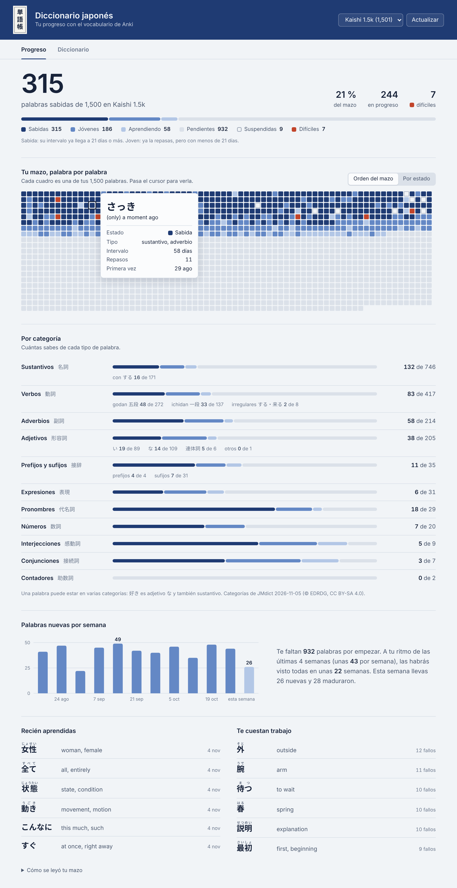

# Anki Diccionario Japonés

Complemento para Anki que te muestra, de forma clara, cuántas palabras de japonés ya sabes, cuántas llevas en progreso y cuántas te faltan de tu mazo. Todo corre dentro de Anki: no necesita internet, cuenta ni página web.



<sub>Vista previa con progreso de ejemplo sobre el mazo Kaishi 1.5k. También: [modo oscuro](docs/vista-previa-oscuro.png) y [pestaña Diccionario](docs/vista-previa-diccionario.png).</sub>

## Qué hace

- Agrega **Diccionario** a la barra de arriba de Anki (junto a Estadísticas) y a **Herramientas**.
- La ventana tiene pestañas: **Progreso** es la página principal y siempre abre primero; **Diccionario** tendrá la lista completa de tus palabras (en construcción).
- Cuenta tus palabras por estado: sabidas, jóvenes, aprendiendo, pendientes y suspendidas, y marca las difíciles.
- Dibuja tu mazo completo como un mapa: cada cuadro es una palabra y se tiñe de índigo más oscuro conforme la aprendes. Al pasar el cursor ves la palabra, su lectura, su significado y su intervalo.
- Clasifica cada palabra por categoría gramatical con JMdict (verbos godan, ichidan e irregulares, sustantivos, adjetivos い y な, adverbios, partículas…) y te dice cuántas sabes de cada una.
- Muestra cuántas palabras nuevas empiezas por semana y calcula en cuánto tiempo terminarías el mazo a tu ritmo.
- Lista las palabras que acabas de aprender y las que más te cuestan.
- Se adapta al modo claro u oscuro de Anki, y al español o inglés.

## Instalar

1. Descarga [`dist/anki_diccionario_japones.ankiaddon`](dist/anki_diccionario_japones.ankiaddon).
2. En Anki: **Herramientas › Complementos › Instalar desde archivo…** y elige el archivo. También puedes darle doble clic.
3. Reinicia Anki y pulsa **Diccionario** en la barra de arriba.

Requiere Anki 2.1.50 o más reciente.

## Cómo cuenta tus palabras

| Estado | Qué significa |
|---|---|
| Sabida | La tarjeta es madura: su intervalo es de 21 días o más. |
| Joven | Ya está en repaso, pero con intervalo menor a 21 días. |
| Aprendiendo | Está en los pasos de aprendizaje o reaprendizaje. |
| Pendiente | Todavía no la has visto. |
| Suspendida | La suspendiste; no cuenta para el porcentaje. |
| Difícil | Tiene 8 fallos o más, o la etiqueta `leech`. Se marca aparte. |

Si una palabra tiene varias tarjetas (por ejemplo, reconocimiento y producción), por defecto cuenta como sabida solo cuando **todas** están maduras. Puedes cambiarlo.

## Funciona con cualquier mazo

El complemento busca solo qué campo tiene la palabra, cuál la lectura y cuál el significado:

1. Primero por el nombre del campo. Reconoce Kaishi, Core 2k/6k, notas de Yomitan/Lapis, campos en japonés (単語, 読み, 意味) y más.
2. Si los nombres no ayudan, mira el contenido de algunas notas: un campo corto con japonés es la palabra, uno solo con kana es la lectura y uno con letras latinas es el significado.
3. Si la palabra trae furigana (`日本[にほん]`), saca de ahí la lectura.

En la parte de abajo del panel, **Cómo se leyó tu mazo** te dice qué campos usó. Si se equivocó, corrígelo en **Herramientas › Complementos › Configuración** con `field_mapping` (ver [`config.md`](anki_diccionario/config.md)).

## Categorías gramaticales

Cada palabra se busca en [JMdict](https://www.edrdg.org/wiki/JMdict-EDICT_Dictionary_Project.html), el diccionario japonés-inglés abierto que usan casi todas las apps:

1. Con la palabra y su lectura juntas, para distinguir palabras que se escriben igual pero se leen distinto.
2. Si la palabra está escrita solo en kana (すぐ, あなた), con la lectura, prefiriendo las palabras comunes que suelen escribirse en kana.
3. Si no la encuentra, prueba sin 〜, sin paréntesis, con la primera de varias formas (`食べ物、食物`) y quitando する (`勉強する` → verbo irregular).

Una palabra puede tener varias etiquetas: 好き es adjetivo な y también sustantivo, así que cuenta en las dos categorías. Las que no aparecen en JMdict quedan como **Sin categoría**.

Si dos palabras se leen igual (いくら "cuánto" e いくら "huevas de salmón"), compara el significado de tu tarjeta con el de JMdict para elegir la correcta. La categoría sale del significado principal de cada palabra, para que usos raros (行く como verbo auxiliar) no inflen los números.

El complemento no trae JMdict completo, solo un índice de palabra, lectura y categorías (`anki_diccionario/data/jmdict_pos.tsv.gz`, 4 MB). La primera vez que abres la ventana lo convierte en una base dentro de `user_files/` para buscar rápido (tarda alrededor de un segundo). Con el mazo Kaishi 1.5k clasifica las 1,500 palabras.

## Estructura

```
Anki Diccionario Japones/
├── anki_diccionario/        el complemento (esto es lo que se instala)
│   ├── __init__.py          punto de entrada
│   ├── window.py            ventana, menú y botón en la barra de Anki
│   ├── collector.py         lee el mazo y arma los datos (JSON)
│   ├── fields.py            detecta campos y limpia el texto
│   ├── categories.py        busca cada palabra en JMdict y le pone sus categorías
│   ├── data/                índice de categorías sacado de JMdict
│   ├── config.json / .md    configuración y su explicación
│   └── web/                 la página del panel (HTML, CSS, JS)
├── dev/                     herramientas para probar sin abrir Anki
├── docs/                    capturas
└── dist/                    el .ankiaddon listo para instalar
```

La ventana es una página web que Anki muestra por dentro. Python lee la colección y le pasa un JSON a la página. Gracias a eso, la misma página podrá exportarse después como sitio aparte.

## Probar sin Anki

```bash
# Pruebas de detección de campos y estados (+ leer un mazo exportado)
python dev/test_collector.py ruta/a/tu_mazo.apkg --json datos.json

# Copia del mazo con progreso inventado, para ver el panel con datos
python dev/make_demo_progress.py collection.anki21 demo.anki21

# Página de vista previa para abrir en el navegador
python dev/build_preview.py datos.json vista.html

# Regenerar el índice de categorías desde el JMdict oficial
# (descárgalo de http://ftp.edrdg.org/pub/Nihongo/JMdict_e.gz)
python dev/build_pos_index.py JMdict_e.gz

# Generar el .ankiaddon
python dev/package.py
```

## Hoja de ruta

- [x] **Parte 1**: leer el mazo, detectar campos y mostrar el progreso
- [x] **Parte 2**: pestañas en la ventana (Progreso siempre es la página principal) y categorías gramaticales automáticas con JMdict (verbos godan/ichidan, adjetivos い/な, sustantivos…), con varias etiquetas por palabra y una sección "Por categoría" en Progreso
- [ ] **Parte 3**: pestaña Diccionario con todas las palabras, búsqueda (kanji, kana, rōmaji, significado) y filtros por estado, categoría, nivel JLPT y kanji compartido
- [ ] **Parte 4**: repaso rápido dentro del complemento: eliges "Te cuestan trabajo" o "Estás aprendiendo", cuántas palabras quieres repasar, y se eligen al azar
- [ ] **Parte 5**: configuración para personalizar el complemento: color de fondo o una imagen propia como fondo
- [ ] **Parte 6**: exportar a una página web aparte

---

Proyecto de Raul Juarez.

Las categorías gramaticales vienen de JMdict, propiedad del [Electronic Dictionary Research and Development Group](https://www.edrdg.org/), y se usan bajo la licencia [CC BY-SA 4.0](https://www.edrdg.org/edrdg/licence.html). El índice derivado (`anki_diccionario/data/`) se distribuye bajo la misma licencia.
