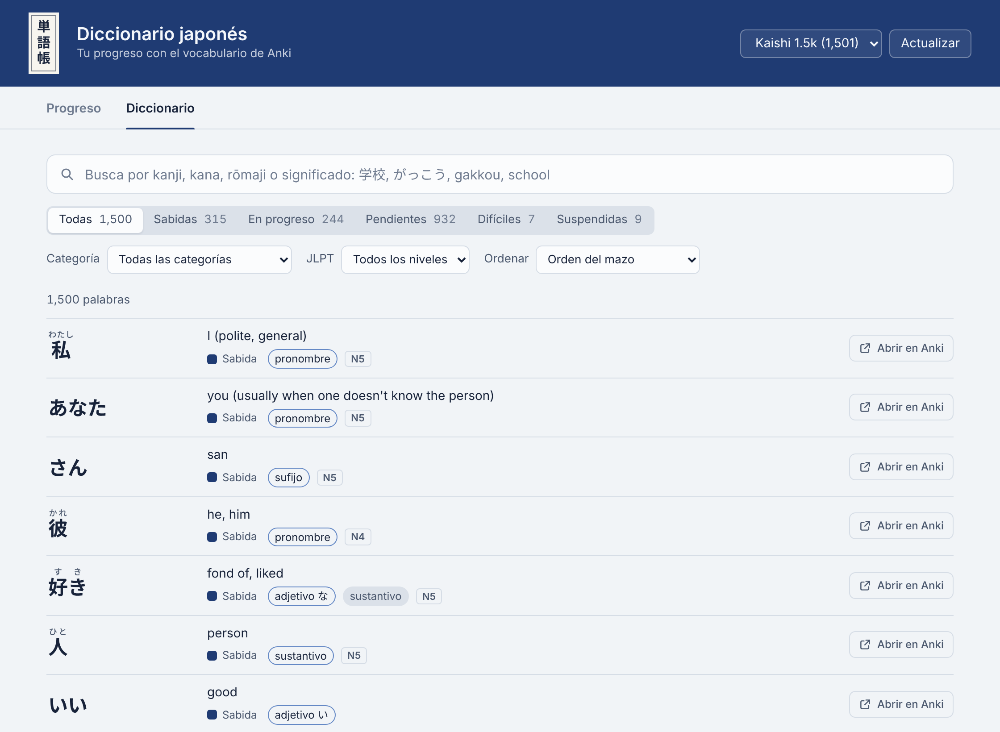
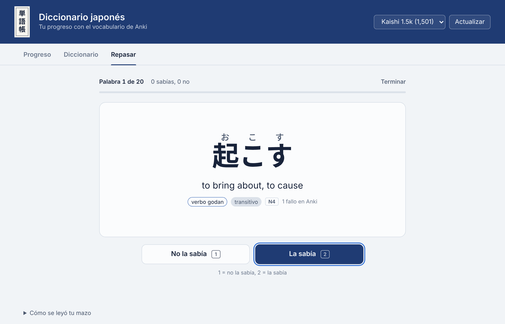
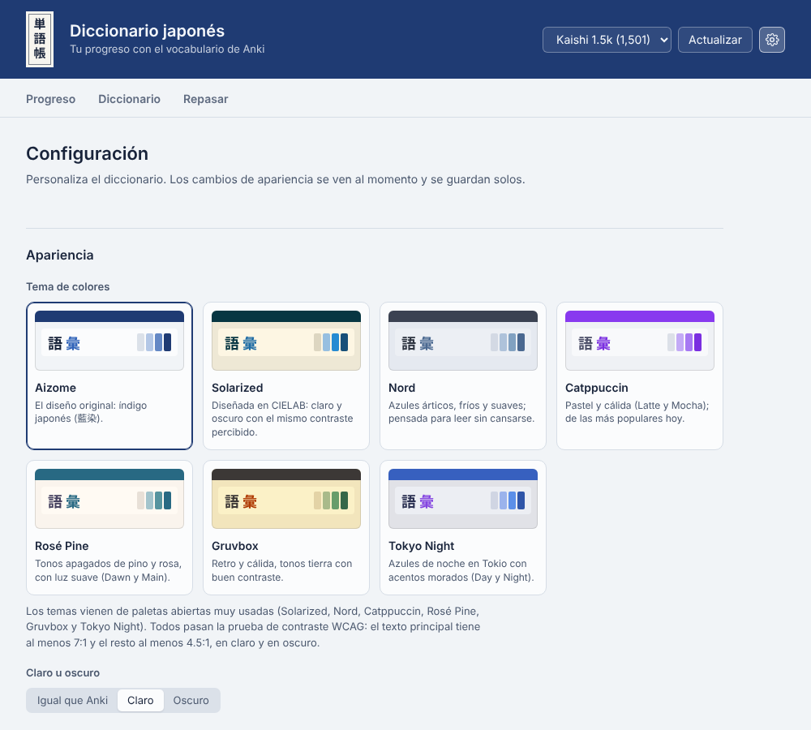
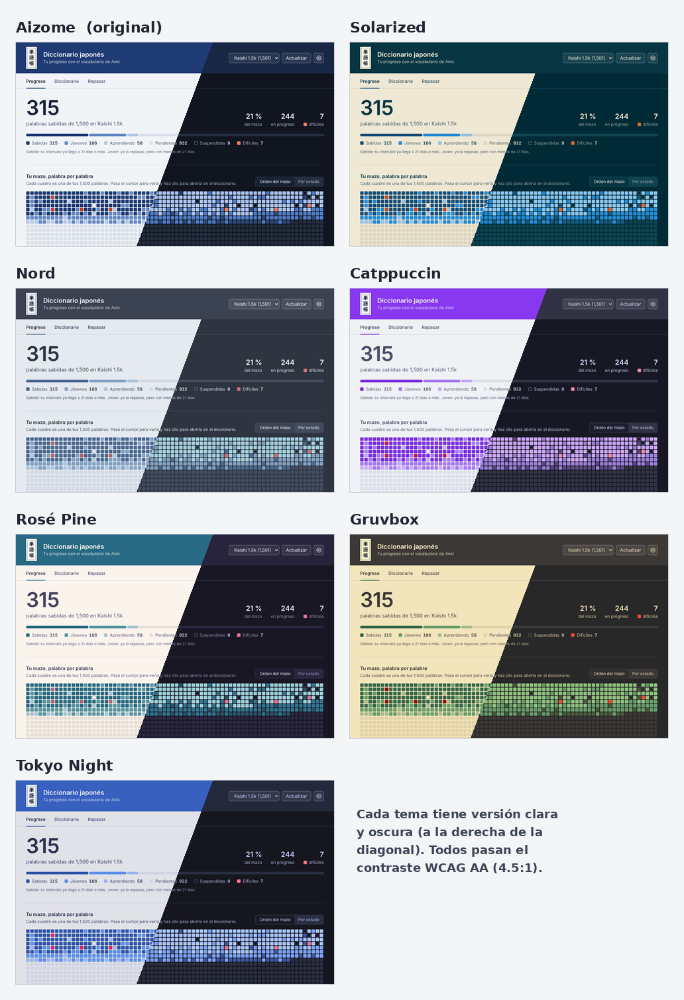

# Anki Diccionario Japonés

Complemento para Anki que te muestra, de forma clara, cuántas palabras de japonés ya sabes, cuántas llevas en progreso y cuántas te faltan de tu mazo. Todo corre dentro de Anki: no necesita internet, cuenta ni página web.






<sub>Vista previa con progreso de ejemplo sobre el mazo Kaishi 1.5k. También en [modo oscuro](docs/vista-previa-oscuro.png), con [los 7 temas de colores](docs/temas.png) y con [una imagen de fondo](docs/fondo-imagen.png).</sub>

## Qué hace

- Se abre con un clic desde **Diccionario** en la barra de menús (junto a Herramientas, Ayuda y otros complementos), desde el botón **Diccionario** junto a Estadísticas o desde **Herramientas › Diccionario japonés**.
- La ventana tiene pestañas: **Progreso** es la página principal y siempre abre primero; **Diccionario** tiene la lista completa de tus palabras; **Repasar** es para practicar.
- Cuenta tus palabras por estado: sabidas, jóvenes, aprendiendo, pendientes y suspendidas, y marca las difíciles.
- Dibuja tu mazo completo como un mapa: cada cuadro es una palabra y se tiñe de índigo más oscuro conforme la aprendes. Al pasar el cursor ves la palabra, su lectura, su significado y su intervalo.
- Clasifica cada palabra por categoría gramatical con JMdict (verbos godan, ichidan e irregulares, sustantivos, adjetivos い y な, adverbios, partículas…) y te dice cuántas sabes de cada una. La sección **Por categoría** aparece como una tira con tus tres categorías más grandes; al picarle se despliega completa.
- Muestra cuántas palabras nuevas empiezas por semana y calcula en cuánto tiempo terminarías el mazo a tu ritmo.
- Lista las palabras que acabas de aprender y las que más te cuestan.
- En **Diccionario** ves todas tus palabras con su furigana, significado, estado, categorías y nivel JLPT:
  - Búsqueda por kanji (学校), kana (がっこう), rōmaji (gakkou) o significado (school).
  - Filtros por estado, categoría (con subtipos: godan, ichidan, adjetivos い/な…), nivel JLPT (N5 a N1) y kanji compartido: picas el 学 de 学校 y ves 学生, 学ぶ, 学園…
  - Orden del mazo, recién aprendidas, más fallos, intervalo más largo o por lectura.
  - Botón **Abrir en Anki** en cada palabra, que abre su tarjeta en el explorador para editarla.
  - Al picarle a una palabra ves su oración de ejemplo con furigana y traducción, con botones para escuchar el audio.
  - Desde Progreso, picarle a una categoría, a "Ver todas" o a un cuadro del mapa te lleva al diccionario ya filtrado.
- En **Repasar** practicas con palabras al azar, sin tocar Anki:
  - Eliges **Te cuestan trabajo** o **Estás aprendiendo** (en aprendizaje o jóvenes), y cuántas: 10, 20, 50, todas u otra cantidad.
  - En **Te cuestan trabajo** eliges a partir de cuántos fallos: 1, 2, 3, 5 o más, o solo las **Difíciles** (8 fallos o más, el mismo criterio de Progreso y de Anki). Si tienes difíciles, esa opción viene elegida.
  - Como en las tarjetas de Kaishi: al frente ves la palabra y abajo su **oración de ejemplo** con la palabra resaltada. Al voltear aparecen la furigana (de la palabra y de la oración), el significado, la traducción de la oración, la categoría y el nivel JLPT, y marcas si la sabías.
  - **Audio**: al voltear suena la palabra y luego la oración, con el mismo reproductor que usa Anki (se puede apagar). Botones ▶ Palabra y ▶ Oración para repetirlo.
  - Atajos: Espacio voltea, 1 = no la sabía, 2 = la sabía, R = repetir el audio.
  - Al final ves cuántas sabías, las que fallaste con su botón **Abrir en Anki**, y puedes repasar solo las falladas.
  - Es solo práctica: **no cambia tus intervalos ni tus estadísticas de Anki**. A Anki solo se le pide reproducir el audio o abrir una tarjeta; nunca se registra un repaso.
- En **Configuración** (el engrane ⚙ arriba a la derecha) eliges entre 7 temas de colores, modo claro u oscuro, un color o una imagen propia de fondo, el idioma, cuándo una palabra cuenta como sabida o difícil, y qué campos de tu mazo usar. Ya no hace falta editar el JSON.
- Se adapta al modo claro u oscuro de Anki, y al español o inglés.

## Instalar

1. Descarga [`dist/anki_diccionario_japones.ankiaddon`](dist/anki_diccionario_japones.ankiaddon).
2. En Anki: **Herramientas › Complementos › Instalar desde archivo…** y elige el archivo. También puedes darle doble clic.
3. Reinicia Anki y pulsa **Diccionario** en la barra de menús.

Requiere Anki 2.1.50 o más reciente.

## Cómo cuenta tus palabras

| Estado | Qué significa |
|---|---|
| Sabida | La tarjeta es madura: su intervalo es de 21 días o más. |
| Joven | Ya está en repaso, pero con intervalo menor a 21 días. |
| Aprendiendo | Está en los pasos de aprendizaje o reaprendizaje. |
| Pendiente | Todavía no la has visto. |
| Suspendida | La suspendiste; no cuenta para el porcentaje. |
| Difícil | Tiene 8 fallos o más, o la etiqueta `leech`. Se marca aparte. |

Si una palabra tiene varias tarjetas (por ejemplo, reconocimiento y producción), por defecto cuenta como sabida solo cuando **todas** están maduras. Puedes cambiarlo.

## Funciona con cualquier mazo

El complemento busca solo qué campo tiene la palabra, cuál la lectura y cuál el significado:

1. Primero por el nombre del campo. Reconoce Kaishi, Core 2k/6k, notas de Yomitan/Lapis, campos en japonés (単語, 読み, 意味) y más.
2. Si los nombres no ayudan, mira el contenido de algunas notas: un campo corto con japonés es la palabra, uno solo con kana es la lectura y uno con letras latinas es el significado.
3. Si la palabra trae furigana (`日本[にほん]`), saca de ahí la lectura.
4. También busca la oración de ejemplo, su furigana, su traducción y los audios de palabra y oración (por ejemplo `Sentence`, `Sentence Furigana`, `Sentence Meaning`, `Word Audio` y `Sentence Audio` en Kaishi; `Expression`, `Sentence-English` y `Vocabulary-Audio` en Core 2k/6k).

En la parte de abajo del panel, **Cómo se leyó tu mazo** te dice qué campos usó. Si se equivocó, corrígelo en **⚙ Configuración › Campos de tu mazo**: cada campo tiene un menú con "Automático", "Ninguno" o el campo que quieras. (También se puede con `field_mapping` en **Herramientas › Complementos › Configuración**; ver [`config.md`](anki_diccionario/config.md).)

## Categorías gramaticales

Cada palabra se busca en [JMdict](https://www.edrdg.org/wiki/JMdict-EDICT_Dictionary_Project.html), el diccionario japonés-inglés abierto que usan casi todas las apps:

1. Con la palabra y su lectura juntas, para distinguir palabras que se escriben igual pero se leen distinto.
2. Si la palabra está escrita solo en kana (すぐ, あなた), con la lectura, prefiriendo las palabras comunes que suelen escribirse en kana.
3. Si no la encuentra, prueba sin 〜, sin paréntesis, con la primera de varias formas (`食べ物、食物`) y quitando する (`勉強する` → verbo irregular).

Una palabra puede tener varias etiquetas: 好き es adjetivo な y también sustantivo, así que cuenta en las dos categorías. Las que no aparecen en JMdict quedan como **Sin categoría**.

Si dos palabras se leen igual (いくら "cuánto" e いくら "huevas de salmón"), compara el significado de tu tarjeta con el de JMdict para elegir la correcta. La categoría sale del significado principal de cada palabra, para que usos raros (行く como verbo auxiliar) no inflen los números.

El complemento no trae JMdict completo, solo un índice de palabra, lectura y categorías (`anki_diccionario/data/jmdict_pos.tsv.gz`, 4 MB). La primera vez que abres la ventana lo convierte en una base dentro de `user_files/` para buscar rápido (tarda alrededor de un segundo). Con el mazo Kaishi 1.5k clasifica las 1,500 palabras.

## Nivel JLPT

El nivel sale de las listas de vocabulario de [open-anki-jlpt-decks](https://github.com/jamsinclair/open-anki-jlpt-decks) (licencia MIT), basadas en las de Jonathan Waller. Desde 2010 no hay listas oficiales del JLPT, así que es una guía. Si una palabra está escrita distinto en la lista (終わる / 終る, ご飯 / 御飯, 出来る / できる), la reconoce si tiene la misma lectura y algún kanji en común. Con Kaishi 1.5k, el 95 % de las palabras tienen nivel.

## Configuración y temas de colores



Todo se cambia desde el engrane ⚙ de la ventana. Los cambios de apariencia se ven al instante y se guardan solos; los que cambian los números (días para "sabida", fallos para "difícil", campos) vuelven a leer el mazo.

**Temas.** Aizome (藍染, el índigo original del complemento) sigue siendo el tema por defecto. Los otros seis vienen de paletas abiertas que mucha gente usa a diario para leer pantallas por horas:

| Tema | Por qué está |
|---|---|
| **Solarized** | Diseñada con el espacio de color CIELAB: sus versiones clara y oscura tienen el mismo contraste percibido. |
| **Nord** | Azules árticos, fríos y apagados, pensados para leer sin cansar la vista. |
| **Catppuccin** | Pastel (Latte de día, Mocha de noche); de los temas más populares hoy. |
| **Rosé Pine** | Tonos apagados de pino y rosa, con luz suave (Dawn y Main). |
| **Gruvbox** | Retro y cálida, tonos tierra con buen contraste. |
| **Tokyo Night** | Azules de noche con acentos morados (Day y Night). |



Cómo se eligieron y ajustaron los colores:

- **Contraste medido, no a ojo.** Cada tema pasa la norma de accesibilidad WCAG 2.1 en claro y en oscuro: el texto principal tiene al menos 7:1 (nivel AAA) y todo lo demás (texto secundario, botones, resaltados) al menos 4.5:1 (nivel AA). Donde la paleta original no llegaba, se oscureció o aclaró ese tono lo mínimo.
- **El mapa se lee igual en todos los temas.** Los cuadros van de "pendiente" a "sabida" siempre de claro a oscuro (u oscuro a claro en modo oscuro), comprobado con la luminosidad L\* de CIELAB, para que "más oscuro = más aprendido" no cambie al cambiar de tema.
- **Azules como base.** En estudios de preferencia de color, los azules y cianes son de los colores que más gusta a la gente y los amarillos oscuros y cafés de los que menos (Palmer y Schloss, 2010). Por eso la mayoría de los temas son azules o índigo, y los cálidos quedan como opción.
- `dev/build_themes.py` revisa todo esto y genera `web/themes.css` y `web/themes.js`; si un tema no pasa, no se genera.

**Fondo.** Puedes dejar el fondo del tema, elegir un color (con sugerencias tomadas de los mismos temas) o poner una imagen propia, como en el complemento *Custom Background*. La imagen se copia a `user_files/`, así que no se pierde si mueves el archivo original ni al actualizar el complemento. Encima se pone un **velo** del color del tema (0 a 95 %) y se puede desenfocar; el panel te avisa si el texto queda con poco contraste sobre ese fondo y te sugiere subir el velo.

**Restablecer.** "Restablecer apariencia" regresa a Aizome sin fondo; "Restablecer todo" regresa todo a como venía, menos el mazo elegido. Los dos piden un segundo clic para confirmar.

## Estructura

```
Anki Diccionario Japones/
├── anki_diccionario/        el complemento (esto es lo que se instala)
│   ├── __init__.py          punto de entrada
│   ├── window.py            ventana, menú y botón en la barra de Anki
│   ├── collector.py         lee el mazo y arma los datos (JSON)
│   ├── fields.py            detecta campos y limpia el texto
│   ├── categories.py        busca cada palabra en JMdict y le pone sus categorías
│   ├── jlpt.py              nivel JLPT de cada palabra
│   ├── settings.py          valida y guarda la Configuración (temas, fondo, campos)
│   ├── data/                índices de categorías (JMdict) y niveles JLPT
│   ├── config.json / .md    configuración y su explicación
│   └── web/                 la página del panel: dashboard.* (Progreso), dictionary.js (Diccionario),
│                            review.js (Repasar), settings.js (Configuración) y themes.* (temas, generados)
├── dev/                     herramientas para probar sin abrir Anki
├── docs/                    capturas
└── dist/                    el .ankiaddon listo para instalar
```

La ventana es una página web que Anki muestra por dentro. Python lee la colección y le pasa un JSON a la página. Gracias a eso, la misma página podrá exportarse después como sitio aparte.

## Probar sin Anki

```bash
# Pruebas de detección de campos y estados (+ leer un mazo exportado)
python dev/test_collector.py ruta/a/tu_mazo.apkg --json datos.json

# Copia del mazo con progreso inventado, para ver el panel con datos
python dev/make_demo_progress.py collection.anki21 demo.anki21

# Página de vista previa para abrir en el navegador
# (--anki carga antes los estilos globales de Anki, para verla como dentro de la app)
python dev/build_preview.py datos.json vista.html --anki

# Regenerar el índice de categorías desde el JMdict oficial
# (descárgalo de http://ftp.edrdg.org/pub/Nihongo/JMdict_e.gz)
python dev/build_pos_index.py JMdict_e.gz

# Regenerar los niveles JLPT (src/ de open-anki-jlpt-decks)
python dev/build_jlpt_index.py open-anki-jlpt-decks/src

# Revisar el contraste de los temas y regenerar web/themes.css y web/themes.js
python dev/build_themes.py

# Generar el .ankiaddon
python dev/package.py
```

## Hoja de ruta

- [x] **Parte 1**: leer el mazo, detectar campos y mostrar el progreso
- [x] **Parte 2**: pestañas en la ventana (Progreso siempre es la página principal) y categorías gramaticales automáticas con JMdict (verbos godan/ichidan, adjetivos い/な, sustantivos…), con varias etiquetas por palabra y una sección "Por categoría" en Progreso
- [x] **Parte 3**: pestaña Diccionario con todas las palabras, búsqueda (kanji, kana, rōmaji, significado), filtros por estado, categoría, nivel JLPT y kanji compartido, y botón para abrir la tarjeta en Anki
- [x] **Parte 4**: repaso rápido dentro del complemento: eliges "Te cuestan trabajo" o "Estás aprendiendo", cuántas palabras quieres repasar, y se eligen al azar (práctica libre, no cambia nada en Anki)
- [x] **Parte 5**: Configuración dentro de la ventana: 7 temas de colores con contraste comprobado (Aizome sigue por defecto), claro/oscuro, color o imagen de fondo con velo, idioma, criterios de "sabida" y "difícil", y elegir campos sin editar el JSON
- [ ] **Parte 6**: exportar a una página web aparte

---

Proyecto de Raul Juarez.

Las categorías gramaticales vienen de JMdict, propiedad del [Electronic Dictionary Research and Development Group](https://www.edrdg.org/), y se usan bajo la licencia [CC BY-SA 4.0](https://www.edrdg.org/edrdg/licence.html). El índice derivado (`anki_diccionario/data/jmdict_pos.tsv.gz`) se distribuye bajo la misma licencia.

Los temas se basan en las paletas de [Solarized](https://ethanschoonover.com/solarized/) (Ethan Schoonover), [Nord](https://www.nordtheme.com/) (Arctic Ice Studio), [Catppuccin](https://catppuccin.com/), [Rosé Pine](https://rosepinetheme.com/), [Gruvbox](https://github.com/morhetz/gruvbox) (Pavel Pertsev) y Tokyo Night ([enkia](https://github.com/enkia/tokyo-night-vscode-theme); variantes Day y Night de [tokyonight.nvim](https://github.com/folke/tokyonight.nvim)), paletas abiertas (MIT; tokyonight.nvim, Apache 2.0), con algunos tonos ajustados para pasar el contraste. Referencias: [WCAG 2.1, contraste mínimo](https://www.w3.org/WAI/WCAG21/Understanding/contrast-minimum.html) y S. E. Palmer y K. B. Schloss, "An ecological valence theory of human color preference", *PNAS* 107 (2010).

Los niveles JLPT vienen de [open-anki-jlpt-decks](https://github.com/jamsinclair/open-anki-jlpt-decks) © 2020 Jamie Sinclair, licencia MIT.
